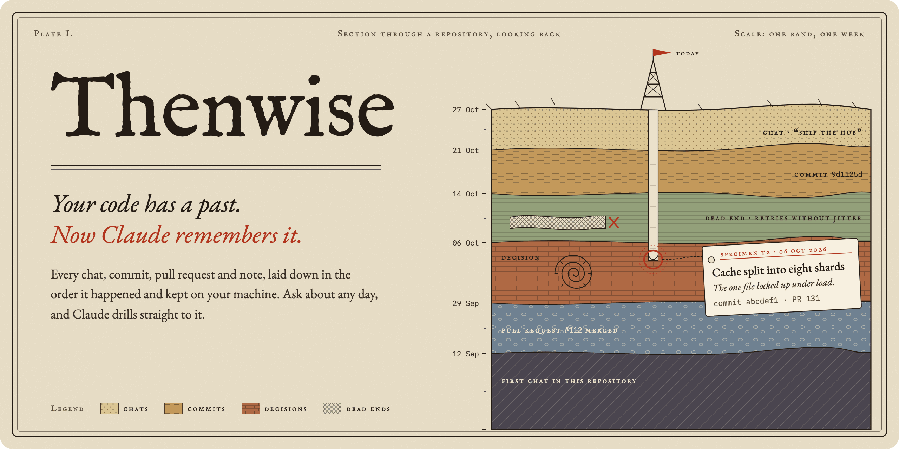
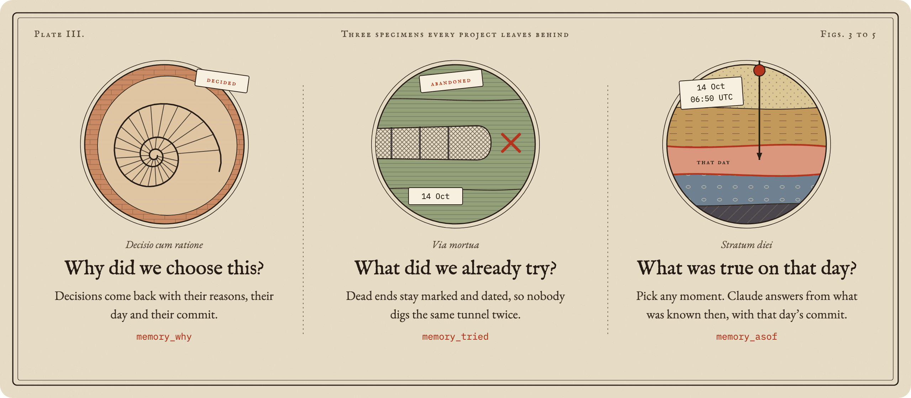
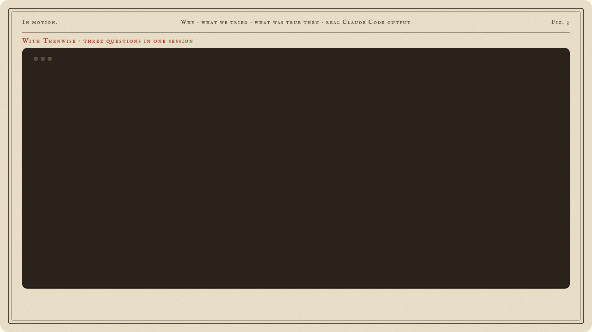
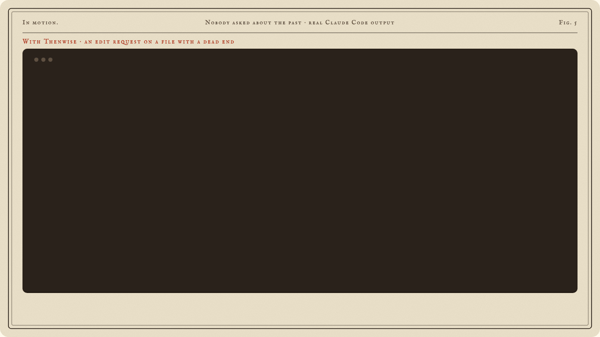
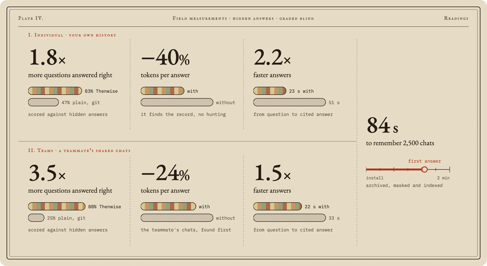
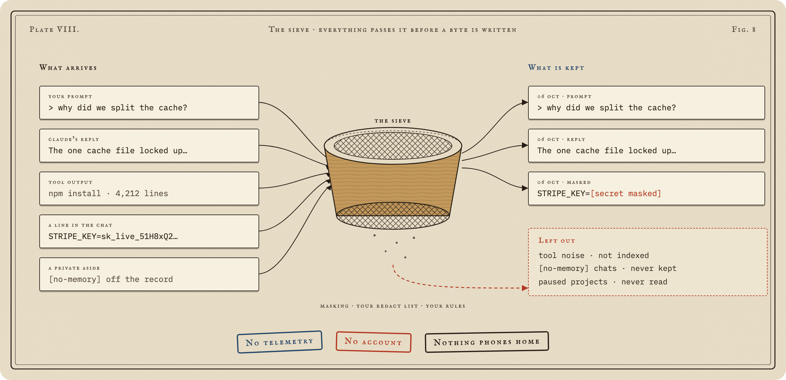
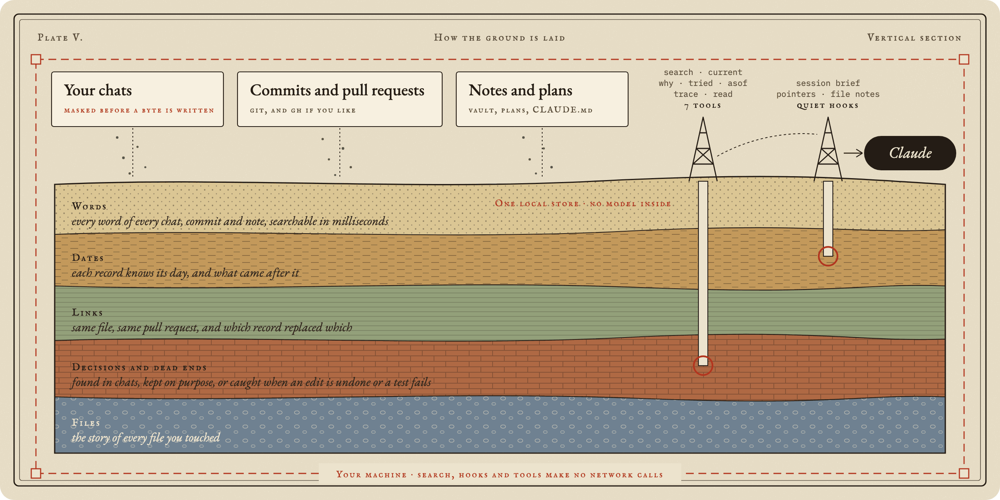
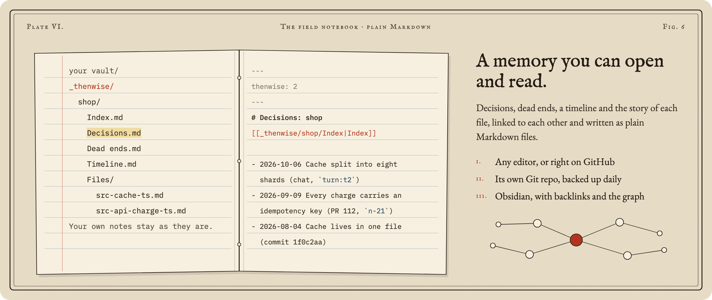
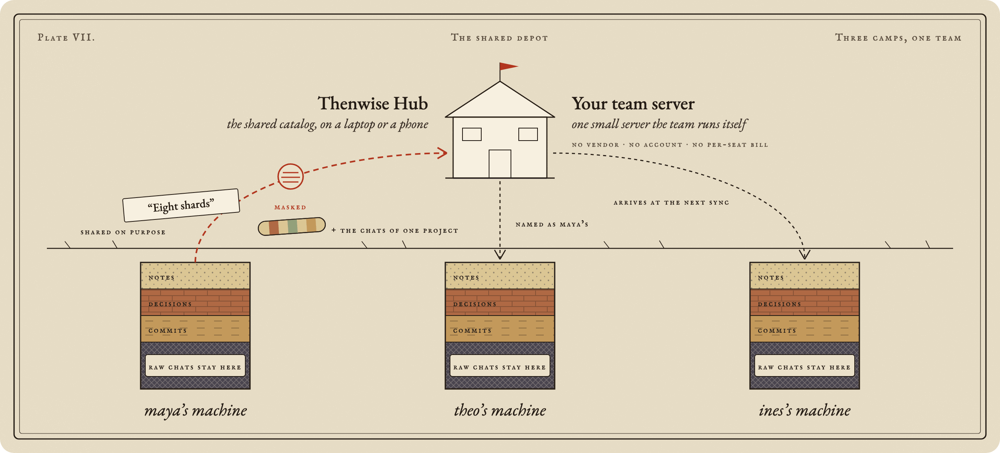

<p align="center"></p>

<p align="center">
  <a href="https://www.npmjs.com/package/thenwise"></a>
  <a href="https://www.npmjs.com/package/thenwise"></a>
  <a href="https://www.npmjs.com/package/thenwise"></a>
  
  <a href="LICENSE"></a>
  <br>
  
  
  <a href="https://github.com/dheerajponnaganti/thenwise/actions/workflows/ci.yml"></a>
  <a href="https://github.com/dheerajponnaganti/thenwise/discussions"></a>
  <a href="CONTRIBUTING.md"></a>
</p>

<h3 align="center">Every decision, every dead end, every yesterday of your Claude Code work.<br>Kept on your machine. Handed back the moment a question needs it.</h3>

<br>

**Thenwise is a Claude Code plugin that gives Claude a local memory of your past chats, commits, pull requests and notes.** Install it in two lines:

```
/plugin marketplace add dheerajponnaganti/thenwise
/plugin install thenwise@thenwise
```

Graded blind on hidden answers: **83%** right against 47% for plain Claude Code on your own history, and **88%** against 25% from a teammate's shared chats. [How we measured](#measured-with-the-answers-hidden).

Your project lays down history every day. A chat settles a question. A commit lands. An idea fails on a Tuesday and nobody writes it down. Weeks later the reason is buried, and Claude starts from zero.

Thenwise keeps every layer, dated and in order, and drills straight to the one that answers.

## The same question, twice

<p align="center"></p>

Same repository, same question, real Claude Code output. That second answer came from a chat you had three weeks ago and forgot about. Thenwise kept it.

## Born for three questions

<p align="center"></p>

In one session, each with its day and its source:

<p align="center"></p>

## The past comes to you

You will not always think to ask. Thenwise slips the right history in at the right moment, and stays quiet the rest of the time.

- **Ask about the past** and Claude gets up to three pointers to the records that answer it, before it starts. A question about the work in front of you gets nothing.
- **Open a project you touched this week** and Claude starts where you left off: the last session, and what landed since.
- **After a compaction**, a short resume brief carries Claude straight back into the work.
- **Open a file** and Claude learns its dead ends and decisions before it changes a line.
- **Across sessions and projects**, the memory follows you.

Ask Claude to change a file with a dead end in its past, and it checks before it edits:

<p align="center"></p>

## Measured, with the answers hidden

Sounds good. Does it hold up? We tested it the hard way.

<p align="center"></p>

Individual: Claude answers about your own history. Teams: a teammate asks about a project they never worked on and answers from its shared chats. In both tests, plain Claude Code could read the repository and its git history. Thenwise runs on its own records: your chats are the core, and git is an add-on that adds commits and pull requests when you have them. [How we measured](docs/eval.md): the questions, the two arms and the blind grading.

## Your memory stays yours

A memory this deep has to be private. This one lives on your disk and nowhere else.

| | |
| --- | --- |
| **Local** | One folder on your disk, readable by you alone. |
| **Masked** | Keys and tokens become `[secret masked]` before a single byte is written. |
| **No middleman** | No model stands between your question and your memory. Search, hooks and tools make zero network calls. |
| **Off the record** | Start or end your first prompt with `[no-memory]`, or give it a line of its own in any prompt, and that whole chat is never kept. |
| **Forgettable** | `thenwise forget` erases a chat or a whole project, and it stays gone. |
| **Chats** | Chats stay home unless you share a project. Raw transcripts never travel. |
| **No telemetry** | No account, no sign-up, no usage reports. Nothing phones home. |

<p align="center"></p>

**What masking catches.** Masking knows the shape of AWS, GitHub, GitLab, Anthropic, OpenAI, Stripe, SendGrid, Twilio, Google, Slack, npm and Hugging Face keys, Slack webhooks, Google OAuth tokens, Docker registry logins, private key blocks, JWTs, passwords inside URLs (even with no user name) and `curl -u`, and any `SECRET=`, `TOKEN=`, `api_key:` or `stripe_key=` style line. It still catches a key that wraps across two lines, and leaves code like `process.env.API_KEY` readable. The team server masks again on arrival.

## How the ground is laid

<p align="center"></p>

Three sources settle into one SQLite store on your disk. Search runs on full text, dates and links, with no model in the way, so an answer comes back in milliseconds and costs nothing. Claude drills in with seven tools, and a few quiet hooks bring records up on their own when the moment calls for it.

### What it keeps, what it leaves out

| Keeps | Leaves out |
| --- | --- |
| Every Claude Code chat: your prompts and Claude's replies, masked | Chats marked `[no-memory]`, and projects you pause |
| Commits from every branch, and pull requests if you like | Tool noise in search: file dumps, long command output and images are not indexed |
| Your CLAUDE.md files, dated, so an old rule and its replacement are told apart | Projects you leave out in `thenwise setup` |
| Every version of your plans, and the notes folders you list | Your own notes are read, never rewritten |

### Fast enough to forget

Hooks answer in about 50 ms and a search takes milliseconds, so Claude never waits on its memory. On your own history, answers came 2.2 times faster and used 40% fewer tokens than plain Claude Code digging through it alone.

## The toolbelt

Claude reaches for these on its own whenever a question needs history.

| Tool | Ask it |
| --- | --- |
| `memory_search` | "Find what we said about the exporter." |
| `memory_current` | "What is the setup now?" |
| `memory_why` | "Why is the limit 600 tokens?" |
| `memory_tried` | "What did we try before shards?" |
| `memory_asof` | "What was the latest release at 06:50 UTC on the 25th?" |
| `memory_trace` | "Tell me the whole story of `src/cache.ts`." |
| `memory_read` | "Show me that record in full." |

Every answer cites its source and date. When a newer record covers the same ground, it is flagged right under the older one.

## A notebook you can open

<p align="center"></p>

Thenwise turns what it remembers into a small library of linked notes: **decisions**, **dead ends**, a **timeline**, and the **history of each file**. We call that folder the vault. It is plain Markdown, nothing more.

- **No Obsidian needed.** Read the notes in VS Code, any text editor, or right on GitHub.
- **Love Obsidian?** Point Thenwise at your vault and the notes land in a `_thenwise/` folder inside it, with working links, backlinks and the graph view.
- **Your choice of home.** `thenwise setup` asks: a folder of its own (`~/Thenwise` by default) or inside your Obsidian vault, one shared vault with a folder per project, or one per project.
- **Your own notes stay yours.** Thenwise reads any notes folders you list, so it can answer from them. It never rewrites them.
- **Backed up if you like.** Keep the vault in its own Git repo or copy it to other folders, once a day.

Write the notes any time with `thenwise vault write`.

## Teams: one memory for the whole team

<p align="center"></p>

Memory tools remember for one person. Thenwise remembers for the team.

- **Your server, your rules.** One small server you run yourself. No vendor, no cloud account, no per-seat bill.
- **Share on purpose.** Nothing leaves until someone picks a note, and every share shows a preview first.
- **Masked on the way out.** Keys and tokens are stripped before a note leaves the machine, and again when it arrives.
- **Chats stay home unless you share a project.** Raw transcripts never travel. Share a project and its chats cross as masked passages, after a preview, and one command takes them back.
- **Core samples, on request.** Name a repo and its past conversations are cut into passages, masked, and sent to the team server. Teammates' Claude finds them like its own memory and names whose chat it was. The Hub shelves them as bound volumes.
- **One search for everyone's past.** What teammates share joins your memory at each sync, so Claude finds it and names who shared it.
- **A reading room in the browser.** [Thenwise Hub](https://github.com/dheerajponnaganti/thenwise-hub) shows the team's notes as a card catalog, with search, history and a review queue, on a laptop or a phone.
- **Offline friendly.** If the server is down, shares wait in a queue and go out on their own.
- **Locked down.** Tokens are stored only as hashes. Five roles run from owner to viewer, and only the owner can reset the owner's token. Repeated failed sign-ins are slowed down and logged. Every admin action lands in an audit log, an optional review queue holds new shares until an admin approves, a backup is one command, and a restore keeps the old database beside the new one.

```
thenwise team serve --dir ~/team --console <hub build>   # on the server
thenwise team invite alice --dir ~/team                   # prints alice's token once
thenwise team join <url> <token>                          # on alice's machine
thenwise share <note>                                     # preview, mask, confirm, send
thenwise team search <words>                              # everything the team shared
thenwise team share-chats <repo path>                     # preview, mask, confirm, send a project's chats
thenwise team unshare-chats <project or session id>       # take them back
```

For the shortest path to a team server, the [`docker/`](docker/) kit runs the server, the Hub and Caddy with automatic certificates. [`docs/teams.md`](docs/teams.md) covers roles, invites, backups and what leaves which machine.

### Solo or team?

Start alone. Add your team when you want to.

| | **Solo** | **Team** |
| --- | --- | --- |
| **What you run** | Nothing. Install the plugin and keep working. | One small server, hosted by one person on the team. |
| **Setup** | `/plugin install`, done. | Plus `team serve` once, then `invite` and `join`. |
| **Server, account, open port** | None of them. | Only that one server, which you own. |
| **Where your memory lives** | Your machine. | Still your machine. Chosen notes also live on the team server. |
| **What leaves your machine** | Nothing. | Only the notes you choose to share, and the chats of projects you share, masked. |
| **Your chats** | Stay home. | Still stay home, unless you share a project's chats. Then masked passages of that project's chats go to the team server. |
| **What search covers** | Your whole history. | Your whole history, plus everything your team shared. |
| **Cost** | Free. | Free, on hardware you already have. |

## Questions people ask

**Does it send my code anywhere?** No. Your code, your chats and your memory stay on your disk. The only things that ever leave are the ones you switch on: PR lookups through `gh`, `distill`, Teams, and an issue report you approve line by line.

**Does it need a model or an API key?** No. No model runs inside Thenwise, so there is no key to add and no extra bill.

**Does it slow Claude down?** No. Hooks take about 50 ms, search takes milliseconds, and in our tests answers arrived 1.5 to 2.2 times faster.

**What does it cost in tokens?** Less than going without: 24% to 40% fewer tokens per answer about the past. In a chat that needs no memory, it adds about 1%.

**How does it fit with CLAUDE.md and Claude's own memory?** They hold your standing rules. Thenwise holds the history: what was decided, what was tried, and what was true on any day. It reads your CLAUDE.md files too.

**Can I delete everything?** Yes. `thenwise forget` erases any chat or project for good, and `thenwise uninstall` stops it and lists every file to remove.

## Install in ten seconds

Ready to give Claude a past?

```
/plugin marketplace add dheerajponnaganti/thenwise
/plugin install thenwise@thenwise
```

On Claude Code 2.1.275 or later, one line does it:

```
/plugin install thenwise --marketplace dheerajponnaganti/thenwise
```

Turn on auto-update for this marketplace in `/plugin`, so fixes reach you on their own.

Ships as built JavaScript, so there is nothing to compile. Runs on macOS, Linux and Windows, and every push passes a fresh install on all three. Needs Node 22.16 or later, and git to read your commits on any host. Want it in your terminal too? `npm install -g thenwise`.

## First run

Start a Claude Code session. Thenwise quietly archives your past chats and builds its store in the background, and every project in `~/.claude/projects` is remembered.

Prefer to choose? Run `thenwise setup`. It lists your projects with chat counts and asks which to keep, where your notes go (a folder of their own or your Obsidian vault), whether to fetch PRs with `gh`, and whether to back up. `thenwise doctor` checks everything and prints one fix line per problem.

Data lives in `~/.thenwise` (or `THENWISE_HOME`).

## Reference

Everything else, folded away until you need it.

<details>
<summary><b>Commands</b></summary>

In Claude Code:

- `/thenwise:status`: what is stored and when it last synced.
- `/thenwise:resume [topic]`: brief Claude on past work.
- `/thenwise:why <words>`, `/thenwise:tried <words>`, `/thenwise:asof <date> <words>`: ask the memory directly.
- `/thenwise:deadend <what failed>` and `/thenwise:decide <what was decided>`: keep a dead end or a decision on purpose.
- `/thenwise:off [all]` and `/thenwise:on [all]`: pause or resume memory for this project, or everywhere.
- `/thenwise:forget <session id or project folder>`: remove a chat or a project from memory.
- `/thenwise:backup`: back up the vault now.
- `/thenwise:inbox [accept <id...> | reject <id...>]`: review the notes Thenwise proposed from your chats, commits and PRs.
- `/thenwise:logs`: the latest log lines, errors first.
- `/thenwise:report [what happened]`: report a problem or an idea. Claude drafts it, you read every line, nothing is sent without your yes.

In the terminal:

- `thenwise setup`, `thenwise doctor`, `thenwise status`.
- `thenwise logs [--errors] [--since 1h]`: what Thenwise did and what failed, also as `/thenwise:logs`.
- `thenwise report [--what <text>] [--send | --open | --copy]`: an issue report with versions, doctor and recent errors, never chat text. Shown in full first; sent only when you say yes.
- `thenwise archive`, `thenwise ingest [--full]`.
- `thenwise search|current|why|tried|trace <words>`, `thenwise asof <date> <words>`, `thenwise resume [words]`, with `--here`, `--project <folder>` or `--all`.
- `thenwise off|on [--project <path>]`.
- `thenwise vault write`: write the curated notes (decisions, dead ends, timeline, file histories) to your vault in a `_thenwise/` folder. Your own notes are read and never rewritten.

Hooks: session start syncs in the background; in a repo with a session in the last 7 days it adds a brief of at most 200 tokens, and after a compaction a resume brief of at most 1,500 tokens. A prompt that asks about the past gets at most three pointers (about 300 tokens); most prompts get nothing. Turn either off with `"hooks": { "prompt_map": false, "startup_brief": false }` in config.json. Opening a file adds its dead ends and decisions, at most 600 tokens, once per file per session. A hook never fails the chat; errors go to the log.

</details>

<details>
<summary><b>Teams, in full</b></summary>

Nothing is shared by default. Chats stay home unless you share a project, and raw transcripts never travel. `thenwise unshare <note>` takes a note back. Invite tokens last one year (`--days N` to change). `thenwise team remove <name>` asks whether to keep or delete that member's notes (`--keep-notes`, `--delete-notes`); a removed name is never handed to someone else, and `team invite --again <name>` brings the same person back to their notes. `team members` lists everyone, `team rotate <name>` replaces a token at once, and `team pull` restores what a machine shared. If the server is down, shares wait in a queue and retry at the next session start. `team serve --console <folder>` serves a built Hub beside the API (`--allow-origin` for a Hub on another host; `--host` beyond this machine needs `--tls-behind-proxy` or `--allow-plain-http`). Admins manage roles, invites and the review queue through the API. `team backup <file>` copies the team database while the server runs, and `team restore <file>` brings it back with the server stopped. Two machines of one person never overwrite each other's edit silently: the newer copy wins, and an older one is reported.

The server binds to 127.0.0.1. For a network, put an https reverse proxy in front of it, at the root or under a path such as `/thenwise`; the client refuses plain http except to localhost. The API is versioned under `/v1` and described in `openapi.json`.

Opt in to more: `"team": { "auto_share": ["decision", "dead_end"], "auto_share_projects": ["<project>"] }` in config.json shares the notes you accept in those projects, and `"capture": { "auto": true }` distills new chats into inbox proposals once a day (through `claude -p`). Both are off by default.

</details>

<details>
<summary><b>Privacy, in full</b></summary>

**Where everything lives.** The data folder (`~/.thenwise`, or `THENWISE_HOME`), folders 0700 and files 0600:

- `archive/`: a masked copy of your Claude Code chats, and `archive/plans/` for plan versions.
- `graph.db`: the search store, built from the archive, git history and notes.
- `notes/`: notes you accepted from `distill`, with its state and log.
- `prs-cache.json` (only if PRs are on), `backup.json`, `vault.json`, `team-server/` (only if you host a team), `config.json`, `logs/` (no chat text, notes or queries), `hook-state/`, `forgotten.json`, `team.json` (only if you join a team).

Claude Code's own chat files are only read, never changed.

**What leaves the machine.** Nothing, until you switch on one of these: PR lookups through `gh`, `distill` (through `claude -p`), Teams (only the notes and project chats you share), and an issue report you approve line by line.

**Forget.**

```sh
thenwise forget <session id>        # one chat
thenwise forget <project folder>    # every chat of a project
```

It shows what will go and asks first (`--yes` skips the question), then removes the chat from the archive, the store, the hook state and vault backups, and unshares team notes made from it. A tombstone keeps it out of every later sync. It also lists what it cannot reach, such as Claude Code's own files and Time Machine copies.

**Off the record.** `[no-memory]` at the start or end of a prompt, or on a line of its own, keeps that chat out entirely. Add your own tags in `ingest.exclude_markers`.

**Pause.** `thenwise off [--project <folder>]` stops archiving, plan history, and reading commits, PRs and CLAUDE.md of that project. Stored records stay until you `forget` them.

**Back up the vault.** Set `backup.kind` to `git` or `folders` in `config.json`. `thenwise backup` runs it now, and the sync runs it once a day. `git` commits the vault in its own repo and pushes only if `backup.push` is true. `folders` copies the vault into each folder in `backup.folders`. Backups never hold the archive or the store.

**Restore.** For `git`: `git -C <vault> log`, then `git checkout <commit> -- _thenwise`. For `folders`: copy `<folder>/<vault name>/_thenwise` back.

**Remove everything.** `thenwise uninstall` stops the background sync and lists what to delete by hand. It deletes nothing itself.

</details>

## Dig in with us

Thenwise grows from the questions people bring to it. Pick your way in.

- **Ask a question.** Start a thread in [Discussions](https://github.com/dheerajponnaganti/thenwise/discussions). No question is too small.
- **Report a bug.** Run `thenwise report`. It fills in the [bug form](https://github.com/dheerajponnaganti/thenwise/issues/new?template=bug.yml) with your versions and the error code, with secrets masked.
- **Suggest an idea.** The [idea form](https://github.com/dheerajponnaganti/thenwise/issues/new?template=idea.yml) asks what you want to do and what gets in the way today.
- **Send a pull request.** Fixes, tests, docs and new secret shapes for the mask are all welcome. [CONTRIBUTING.md](CONTRIBUTING.md) gets you from clone to green tests in three commands.
- **Show what it found.** Post the answer that saved your afternoon in [Show and tell](https://github.com/dheerajponnaganti/thenwise/discussions/categories/show-and-tell).
- **Star the repo**, so the next person finds it.

Found a security problem? Report it privately, as [SECURITY.md](SECURITY.md) describes.

---

<p align="center"><b>Thenwise</b>: wise about then.<br><sub>Apache 2.0 · see <code>LICENSE</code></sub></p>
