<p align="center"></p>

<p align="center">
  
  
  
  
  
</p>

<p align="center"><b>Every decision, every dead end, every yesterday of your Claude Code work,<br>kept on your machine and handed back the moment a question needs it.</b></p>

<p align="center"></p>

That second answer came from a chat you had weeks ago and forgot about. Thenwise did not.

## Born for three questions

Every project collects answers nobody wrote down. Thenwise keeps them and hands them back when you ask.

<p align="center"></p>

## It keeps the thread for you

You do not always have to ask. Some of it arrives on its own, at the right moment.

- **When you ask about the past**, Claude gets up to three pointers to the records that answer it, before it even starts. A question about the work at hand gets nothing.
- **When you open a project you worked on this week**, Claude starts with where it stood: the last session, and what landed since.
- **After a compaction**, Claude gets a short resume brief and carries on where it left off.
- **When Claude opens a file**, it learns that file's dead ends and decisions before touching it.
- **Plans never vanish.** Every version of your [planning-with-files](https://github.com/othmanadi/planning-with-files) plans is saved before it gets overwritten, so last week's plan is one search away.
- **Across sessions and projects**, the memory follows you.

## Measured, with hidden answers

Sounds nice. Does it work? We tested it the hard way.

<p align="center"></p>

## Your memory never leaves home

A memory this deep has to be private. This one never leaves your disk.

| | |
| --- | --- |
| **Local** | One folder on your disk, readable by you alone. |
| **Masked** | Keys and tokens become `[secret masked]` before a single byte is written. |
| **No middleman** | No model stands between your question and your memory. Search, hooks and tools make zero network calls. |
| **Off the record** | Put `[no-memory]` in a prompt and that whole chat is never kept. |
| **Forgettable** | `thenwise forget` erases a chat or a whole project, and it stays gone. |

## Behind the curtain

Three sources, one store, and Claude asks it when a question needs the past.

<p align="center"></p>

## The toolbelt

Claude reaches for these on its own whenever a question needs history.

| Tool | Ask it |
| --- | --- |
| `memory_search` | "Find what we said about the exporter." |
| `memory_current` | "What is the setup now?" |
| `memory_why` | "Why is the limit 600 tokens?" |
| `memory_tried` | "What did we try before shards?" |
| `memory_asof` | "What was the latest release at 06:50 UTC on the 25th?" |
| `memory_trace` | "Tell me the whole story of `src/cache.ts`." |
| `memory_read` | "Show me that record in full." |

Every answer cites its source and date, and a newer record on the same topic is flagged right under the older one.

## Your notes, as plain Markdown

A memory you can only query is half a memory. This one you can also read.

<p align="center"></p>

Thenwise can turn what it remembers into a small library of notes you can read and keep: **decisions**, **dead ends**, a **timeline**, and the **history of each file**, all linked to each other. We call that folder the vault. It is a folder of Markdown files, nothing more.

- **No Obsidian needed.** Open the notes in VS Code, any text editor, or right on GitHub.
- **Love Obsidian?** Point Thenwise at your Obsidian vault and the notes land in a `_thenwise/` folder inside it, with working links, backlinks and the graph view.
- **Two places to choose from.** `thenwise setup` asks: a central folder of its own (`~/Thenwise` by default), or inside your existing Obsidian vault. One shared vault with a folder per project, or one per project.
- **Your own notes stay yours.** Thenwise also reads any notes folders you list, so it can answer from them. It never rewrites them.
- **Backed up if you like.** Keep the vault in its own Git repo or copy it to other folders, once a day.

Write the notes any time with `thenwise vault write`.

## Solo or team?

Start alone. Add your team when you want to.

| | **Solo** | **Team** |
| --- | --- | --- |
| **What you run** | Nothing. Install the plugin and keep working. | One small server, hosted by one person on the team. |
| **Setup** | `/plugin install`, done. | Plus `team serve` once, then `invite` and `join`. |
| **Server, account, open port** | None of them. | Only that one server, which you own. |
| **Where your memory lives** | Your machine. | Still your machine. Chosen notes also live on the team server. |
| **What leaves your machine** | Nothing. | Only the notes you choose to share, masked. |
| **Your chats** | Stay home. | Still stay home. |
| **What search covers** | Your whole history. | Your whole history, plus everything your team shared. |
| **Cost** | Free. | Free, on hardware you already have. |

## Teams: a memory your whole team shares

<p align="center"></p>

Memory tools remember for one person. Thenwise remembers for the whole team.

- **Your server, your rules.** One small server you run yourself. No vendor, no cloud account, no per-seat bill.
- **Share on purpose.** Nothing is shared until someone picks a note. Each share shows a preview first.
- **Masked on the way out.** Keys and tokens are stripped before a note leaves the machine.
- **Chats stay home.** Raw conversations never leave anyone's laptop. Only the decisions and dead ends you choose travel.
- **Search the team's past.** What teammates share joins your memory at each sync, so Claude finds it and names who shared it. `thenwise team search` finds it from the terminal too.
- **Offline friendly.** If the server is down, shares wait in a queue and go out on their own.

```
thenwise team serve --port 8787      # on the server
thenwise team invite alice           # prints alice's token once
thenwise team join <url> <token>     # on alice's machine
thenwise share <note>                # preview, mask, confirm, send
thenwise team search <words>         # search everything the team shared
```

## Install in ten seconds

Ready to give Claude a past?

```
/plugin marketplace add dheerajponnaganti/thenwise
/plugin install thenwise@thenwise
```

On Claude Code 2.1.275 or later, one line does it:

```
/plugin install thenwise --marketplace dheerajponnaganti/thenwise
```

Ships as built JavaScript, so there is nothing to compile. Needs Node 22.16 or later. Want it in your terminal too? `npm install -g thenwise`.

## First run

Start a Claude Code session. Thenwise quietly archives your past chats and builds its store in the background, and every project in `~/.claude/projects` is remembered.

Prefer to choose? Run `thenwise setup`. It lists your projects with chat counts and asks which to keep, where your notes go (a folder of their own or your Obsidian vault), whether to fetch PRs with `gh`, and whether to back up. `thenwise doctor` checks everything and prints one fix line per problem.

Data lives in `~/.thenwise` (or `THENWISE_HOME`).

## Reference

Everything else, folded away until you need it.

<details>
<summary><b>⌨Commands</b></summary>

In Claude Code:

- `/thenwise:status`: what is stored and when it last synced.
- `/thenwise:resume [topic]`: brief Claude on past work.
- `/thenwise:why <words>`, `/thenwise:tried <words>`, `/thenwise:asof <date> <words>`: ask the memory directly.
- `/thenwise:deadend <what failed>` and `/thenwise:decide <what was decided>`: keep a dead end or a decision on purpose.
- `/thenwise:off [all]` and `/thenwise:on [all]`: pause or resume memory for this project, or everywhere.
- `/thenwise:forget <session id or project folder>`: remove a chat or a project from memory.
- `/thenwise:backup`: back up the vault now.
- `/thenwise:logs`: the latest log lines, errors first.
- `/thenwise:report [what happened]`: report a problem or an idea. Claude drafts it, you read every line, nothing is sent without your yes.

In the terminal:

- `thenwise setup`, `thenwise doctor`, `thenwise status`.
- `thenwise logs [--errors] [--since 1h]`: what Thenwise did and what failed, also as `/thenwise:logs`.
- `thenwise report [--what <text>] [--send | --open | --copy]`: an issue report with versions, doctor and recent errors, never chat text. Shown in full first; sent only when you say yes.
- `thenwise archive`, `thenwise ingest [--full]`.
- `thenwise search|current|why|tried|trace <words>`, `thenwise asof <date> <words>`, `thenwise resume [words]`, with `--here`, `--project <folder>` or `--all`.
- `thenwise off|on [--project <path>]`.
- `thenwise vault write`: write the curated notes (decisions, dead ends, timeline, file histories) to your vault in a `_thenwise/` folder. Your own notes are read and never rewritten.

Hooks: session start syncs in the background; in a repo with a session in the last 7 days it adds a brief of at most 200 tokens, and after a compaction a resume brief of at most 1,500 tokens. A prompt that asks about the past gets at most three pointers (about 300 tokens); most prompts get nothing. Turn either off with `"hooks": { "prompt_map": false, "startup_brief": false }` in config.json. Opening a file adds its dead ends and decisions, at most 600 tokens, once per file per session. A hook never fails the chat; errors go to the log.

</details>

<details>
<summary><b>Teams, in full</b></summary>

Nothing is shared by default, and raw chats never leave the machine. `thenwise unshare <note>` takes a note back. Invite tokens last one year (`--days N` to change). `thenwise team remove <name>` asks whether to keep or delete that member's notes (`--keep-notes`, `--delete-notes`); a removed name is never handed to someone else, and `team invite --again <name>` brings the same person back to their notes. `team members` lists everyone, `team rotate <name>` replaces a token at once, and `team pull` restores what a machine shared. If the server is down, shares wait in a queue and retry at the next session start. `team serve --console <folder>` serves a built Hub beside the API (`--allow-origin` for a Hub on another host; `--host` beyond this machine needs `--tls-behind-proxy` or `--allow-plain-http`). Admins manage roles, invites and the review queue through the API. Two machines of one person never overwrite each other's edit silently: the newer copy wins, and an older one is reported.

The server binds to 127.0.0.1. For a network, put an https reverse proxy in front of it, at the root or under a path such as `/thenwise`; the client refuses plain http except to localhost. The API is versioned under `/v1` and described in `openapi.json`.

</details>

<details>
<summary><b>Privacy, in full</b></summary>

**Where everything lives.** The data folder (`~/.thenwise`, or `THENWISE_HOME`), folders 0700 and files 0600:

- `archive/`: a masked copy of your Claude Code chats, and `archive/plans/` for plan versions.
- `graph.db`: the search store, built from the archive, git history and notes.
- `notes/`: notes you accepted from `distill`, with its state and log.
- `prs-cache.json` (only if PRs are on), `backup.json`, `vault.json`, `team-server/` (only if you host a team), `config.json`, `logs/` (no chat text, notes or queries), `hook-state/`, `forgotten.json`, `team.json` (only if you join a team).

Claude Code's own chat files are only read, never changed.

**What leaves the machine.** Nothing, until you switch on one of these: PR lookups through `gh`, `distill` (through `claude -p`), Teams (only the notes you share), and an issue report you approve line by line.

**Forget.**

```sh
thenwise forget <session id>        # one chat
thenwise forget <project folder>    # every chat of a project
```

It shows what will go and asks first (`--yes` skips the question), then removes the chat from the archive, the store, the hook state and vault backups, and unshares team notes made from it. A tombstone keeps it out of every later sync. It also lists what it cannot reach, such as Claude Code's own files and Time Machine copies.

**Off the record.** `[no-memory]` at the start or end of a prompt, or on a line of its own, keeps that chat out entirely. Add your own tags in `ingest.exclude_markers`.

**Pause.** `thenwise off [--project <folder>]` stops archiving, plan history, and reading commits, PRs and CLAUDE.md of that project. Stored records stay until you `forget` them.

**Back up the vault.** Set `backup.kind` to `git` or `folders` in `config.json`. `thenwise backup` runs it now, and the sync runs it once a day. `git` commits the vault in its own repo and pushes only if `backup.push` is true. `folders` copies the vault into each folder in `backup.folders`. Backups never hold the archive or the store.

**Restore.** For `git`: `git -C <vault> log`, then `git checkout <commit> -- _thenwise`. For `folders`: copy `<folder>/<vault name>/_thenwise` back.

**Remove everything.** `thenwise uninstall` stops the background sync and lists what to delete by hand. It deletes nothing itself.

</details>

---

<p align="center"><b>Thenwise</b>: wise about then.<br><sub>Apache 2.0 · see <code>LICENSE</code></sub></p>
