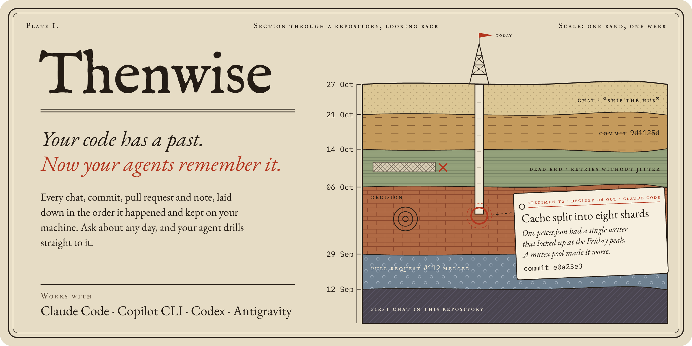
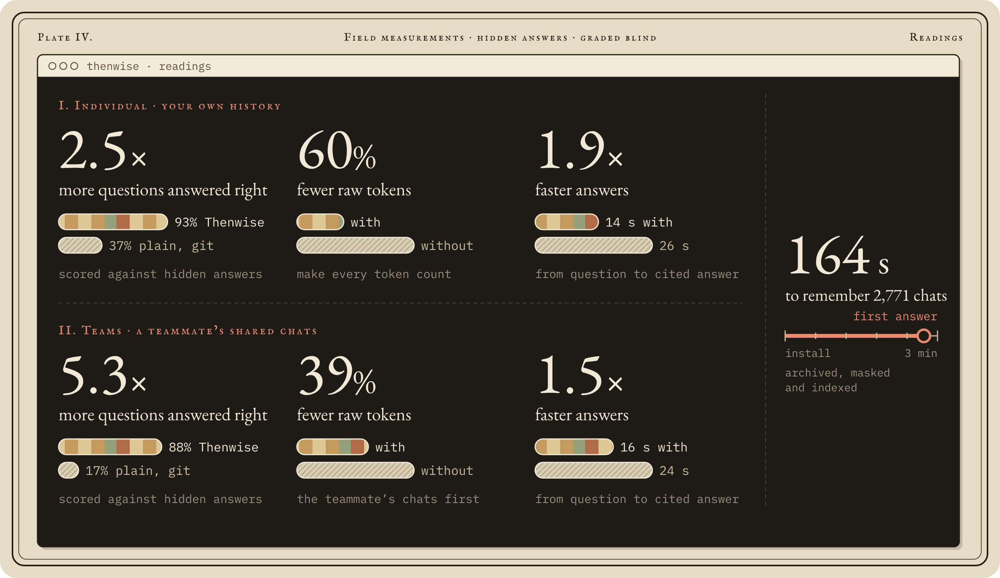
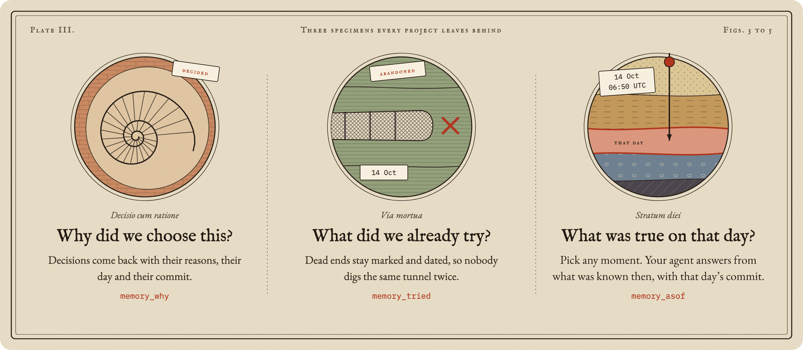
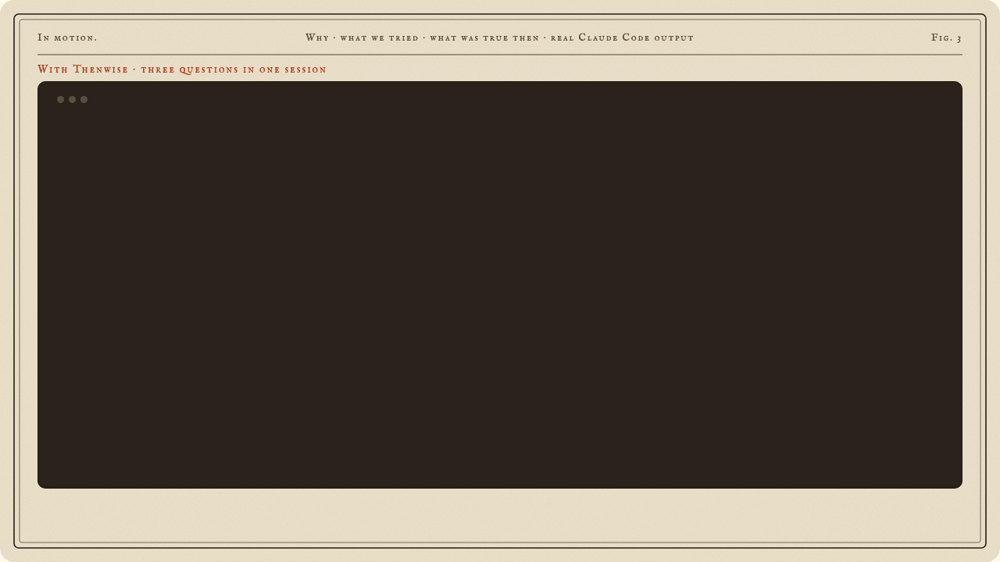
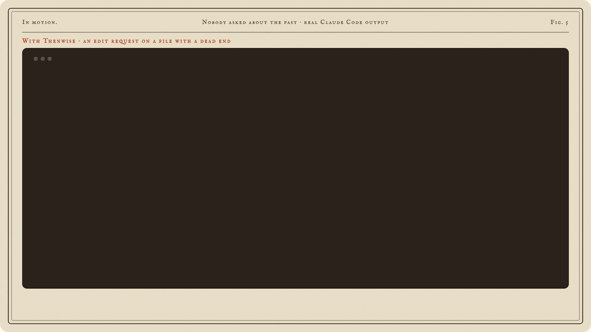
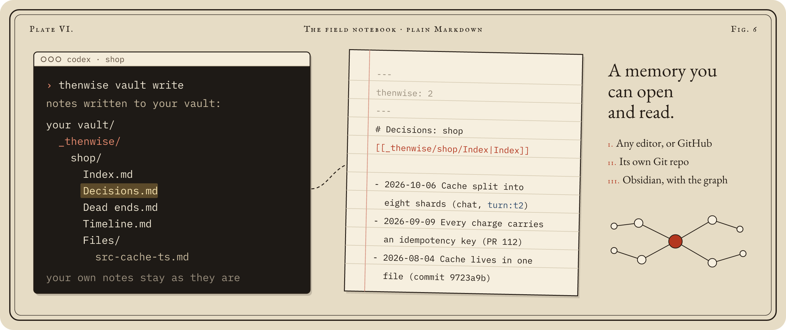
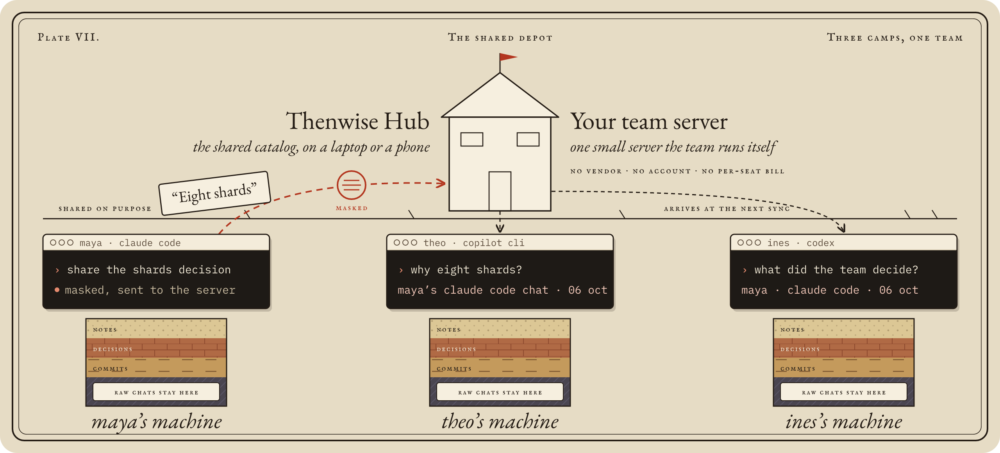
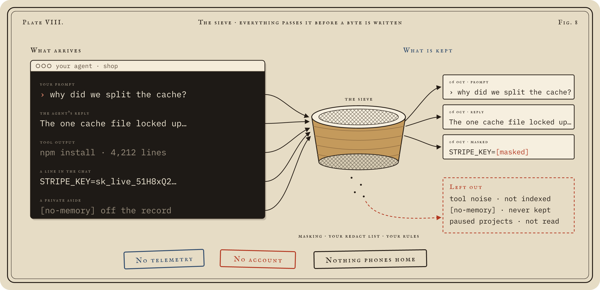

<p align="center"></p>

<p align="center">
  <a href="https://thenwise.dev"></a>
  <a href="https://www.npmjs.com/package/thenwise"></a>
  <a href="https://www.npmjs.com/package/thenwise"></a>
  <a href="https://www.npmjs.com/package/thenwise"></a>
  
  <a href="LICENSE"></a>
  <br>
  
  
  <a href="https://github.com/dheerajponnaganti/thenwise/actions/workflows/ci.yml"></a>
  <a href="https://github.com/dheerajponnaganti/thenwise/discussions"></a>
  <a href="CONTRIBUTING.md"></a>
</p>

<h3 align="center">Every decision, every dead end, every yesterday of your work with coding agents.<br>Kept on your machine. Handed back the moment a question needs it.</h3>

<br>

**Thenwise gives Claude Code, Copilot CLI, Codex and Antigravity one local memory of your past chats, commits, pull requests and notes.**

Your project lays down history every day. A chat settles a question. A commit lands. An idea fails on a Tuesday and nobody writes it down. Weeks later the reason is buried, and your agent starts from zero. Thenwise keeps every layer, dated and in order, and drills straight to the one that answers.

## Install

Install it in each tool you use. They all share one memory. You need Node 22.16 or later, on macOS, Linux or Windows.

<table>
<tr><th>Claude Code<br><sub>type the commands in a Claude Code chat</sub></th><th>Copilot CLI<br><sub>run in your terminal</sub></th></tr>
<tr><td>

```
# 1. Add the Thenwise marketplace (once)
/plugin marketplace add dheerajponnaganti/thenwise

# 2. Install the plugin from it
/plugin install thenwise@thenwise

# 3. Quit and start a new session
```

</td><td>

```
# 1. Add the Thenwise marketplace (once)
copilot plugin marketplace add dheerajponnaganti/thenwise

# 2. Install the plugin from it
copilot plugin install thenwise@thenwise

# 3. Start a new copilot session
```

</td></tr>
<tr><th>Codex<br><sub>run in your terminal</sub></th><th>Antigravity<br><sub>run in your terminal</sub></th></tr>
<tr><td>

```
# 1. Add the Thenwise marketplace (once)
codex plugin marketplace add dheerajponnaganti/thenwise

# 2. Install the plugin from it
codex plugin add thenwise@thenwise

# 3. Start codex, open /hooks and trust
#    Thenwise's hooks, then start a new session
```

</td><td>

```
# 1. Install the plugin straight from GitHub
agy plugin install https://github.com/dheerajponnaganti/thenwise/tree/main/plugin

# 2. Start a new agy session
```

</td></tr>
</table>

On the first new session, Thenwise reads your past chats in the background and shows one line when it starts. Antigravity's CLI and its app both count. There is nothing else to set up.

Cursor, Gemini CLI and OpenCode read the same memory with `npm install -g thenwise` and `thenwise connect cursor` (or `gemini`, `opencode`). Auto-update, sandboxes and the one-line install: [docs/install.md](docs/install.md).

## What happens after you install

<p align="center"></p>

No model, no API key, no account, nothing to configure. Want to choose? `thenwise setup` asks which projects to keep, where your notes go, whether to fetch pull requests, and whether to back up. `thenwise doctor` checks everything and prints one fix line per problem.

## Measured, with the answers hidden

Make every token count. We tested it the hard way.

<p align="center"></p>

**Individual:** your agent answers about your own history. **Teams:** a teammate asks about a project they never worked on and answers from its shared chats. In both tests, plain Claude Code could read the repository and its git history, and a judge graded every answer without knowing which side wrote it. Hooks answer in about 50 ms and a search takes milliseconds, so your agent never waits on its memory. [How we measured](docs/eval.md), with a run for every tool.

## What it does for you

### The same question, twice

<p align="center"></p>

Same repository, same question, real output. That second answer came from a chat you had three weeks ago and forgot about. Thenwise kept it.

### Born for three questions

<p align="center"></p>

In one session, each with its day and its source:

<p align="center"></p>

### The past comes to you

You will not always think to ask. Thenwise brings the right history in at the right moment, and stays quiet the rest of the time.

- **Open a file** and your agent learns its dead ends and decisions before it changes a line.
- **Ask about the past** and it gets up to three pointers to the records that answer it. A question about the work in front of you gets nothing.
- **Open a project you touched this week** and it starts where you left off.
- **After a compaction**, a short resume brief carries it straight back into the work.
- **Dead ends are found on their own.** A reverted commit, an edit that was undone, a test that failed before the work moved on, a line like "that didn't work": each is marked, with no model and nothing for you to write down.
- **Across sessions, projects and tools**, the memory follows you. A second clone of the same repo counts as the same project.

Ask it to change a file with a dead end in its past, and it checks before it edits:

<p align="center"></p>

### What it is great at

- **Coming back after three weeks.** Open the project and your agent knows where you stopped, what landed since and what is still open.
- **"Why is this like this?"** An odd config value, a pinned version, a strange workaround: the reason comes back with its day and its commit.
- **Not digging the same tunnel twice.** Before it edits a file, your agent sees what was tried there and failed.
- **"What was the setup on release day?"** Ask about any date and get what was true then.
- **Rules that changed.** Your CLAUDE.md files and plans are kept, every version dated, so an old rule and its replacement are told apart.
- **Joining someone else's project.** With a teammate's shared chats, the reasons behind the code arrive on your first day.
- **Running out mid-task.** Switch tools and carry on. The next one starts where the last one stopped.

### A notebook you can open

<p align="center"></p>

`thenwise vault write` turns what it remembers into linked notes: **decisions**, **dead ends**, a **timeline**, and the **history of each file**. It is plain Markdown. Read it in any editor or on GitHub, keep it in its own Git repo, or point it at your Obsidian vault for backlinks and the graph. Notes you accept from `/thenwise:inbox` join it, and `/thenwise:backup` copies it to git or other folders once a day. Thenwise reads your own notes folders too, and never rewrites them.

## What it does for your team

<p align="center"></p>

Memory tools remember for one person. Thenwise remembers for the team. Asked about a project they never worked on, a teammate's agent answered 88% right from shared chats, against 17% from git alone.

- **Your server, your rules.** One small server you run yourself. No vendor, no cloud account, no per-seat bill.
- **Share on purpose.** Nothing leaves until someone picks a note or a project. Every share shows a preview, and keys are masked on the way out and again on arrival.
- **Chats stay home unless you share a project.** Raw transcripts never travel. A shared project's chats cross as masked passages, and one command takes them back.
- **One search for everyone's past.** What teammates share joins your memory at each sync. Your agent finds it like its own and names whose it is and from which tool: "Copilot chat of alice".
- **See a teammate's work in progress.** A teammate's half-finished chat shows in your session brief, with their tool and where they stopped. Open a file they touched today, and your agent hears who, how long ago, and whether their chat was cut off.
- **Locked down.** Tokens are stored only as hashes. Five roles run from owner to viewer, every admin action lands in an audit log, and an optional review queue holds new shares until an admin approves. If the server is down, shares wait and go out on their own.
- **A reading room in the browser.** [Thenwise Hub](https://github.com/dheerajponnaganti/thenwise-hub) shows the team's notes as a card catalog, with search, history and a review queue.

Maya opens the shop project while alice's Copilot chat is stopped halfway through the same file:

<p align="center"></p>

```
thenwise team serve --dir ~/team --console <hub build>   # on the server
thenwise team invite alice --dir ~/team                   # prints alice's token once
thenwise team join <url> <token>                          # on alice's machine
thenwise share <note>                                     # preview, mask, confirm, send
thenwise team share-chats <repo path>                     # share a project's chats
```

| | **Solo** | **Team** |
| --- | --- | --- |
| **What you run** | Nothing. Install the plugin and keep working. | One small server, hosted by one person on the team. |
| **What leaves your machine** | Nothing. | Only the notes and project chats you choose to share, masked. |
| **What search covers** | Your whole history. | Your whole history, plus everything your team shared. |
| **Cost** | Free. | Free, on hardware you already have. |

The [`docker/`](docker/) kit runs the server, the Hub and Caddy with automatic certificates. Roles, invites, backups and what leaves which machine: [docs/teams.md](docs/teams.md).

## One memory, every tool

Decide it in Claude Code. Ask about it in Copilot. Run out in one tool and carry on in another. The handoff reads the other tool's own chat file the moment you switch, with no sync to wait for.

<p align="center"></p>

The next agent learns why the last one stopped (a usage limit, a step that never finished, or its last reply), the task, the files it edited, the last test and whether it passed, the commits, the dead ends, and what is uncommitted now:

<p align="center"></p>

Leave a question for whoever comes next: a line `[question] <the question>` in any chat shows in the next agent's handoff and in your teammates' briefs, and stays open for a week until a later chat answers it.

## Your memory stays yours

A memory this deep has to be private. This one lives on your disk and nowhere else.

| | |
| --- | --- |
| **Local** | One folder on your disk, readable by you alone. |
| **Masked** | Keys and tokens become `[secret masked]` before a single byte is written. |
| **No middleman** | No model stands between your question and your memory. Search, hooks and tools make zero network calls. |
| **Off the record** | Start or end a prompt with `[no-memory]`, or give it a line of its own, and that whole chat is never kept. |
| **Forgettable** | `thenwise forget` erases a chat or a whole project, and it stays gone. |
| **Read only** | Each tool's own chat files and your own notes are read, never changed. |
| **No telemetry** | No account, no sign-up, no usage reports. Nothing phones home. |

<p align="center"></p>

Masking knows the shape of keys from AWS, GitHub, GitLab, Anthropic, OpenAI, Stripe, Slack, npm, Hugging Face and more, with private key blocks, JWTs and passwords inside URLs. [Every file it keeps, and everything masking catches](docs/privacy.md).

## Commands and hooks

### Eight memory tools

Your agent reaches for these on its own whenever a question needs history.

| Tool | Ask it |
| --- | --- |
| `memory_search` | "Find what we said about the exporter." |
| `memory_current` | "What is the setup now?" |
| `memory_why` | "Why is the limit 600 tokens?" |
| `memory_tried` | "What did we try before shards?" |
| `memory_asof` | "What was the latest release at 06:50 UTC on the 25th?" |
| `memory_trace` | "Tell me the whole story of `src/cache.ts`." |
| `memory_read` | "Show me that record in full." |
| `memory_resume` | "Continue where the last session stopped." |

Every result names its day, its project and the tool it came from. When a newer record replaces an older one, it is flagged right under it. When no record holds all of a question's rare words, the answer says so, so a near miss is never passed off as the answer.

### The commands you will use

| Command | What it does |
| --- | --- |
| `/thenwise:status` | What is stored and when it last synced. |
| `/thenwise:resume [topic]` | Brief your agent on past work. |
| `/thenwise:why`, `/thenwise:tried`, `/thenwise:asof` | Ask the memory directly. |
| `/thenwise:decide`, `/thenwise:deadend` | Keep a decision or a dead end on purpose. |
| `/thenwise:shown` | Exactly what Thenwise added to this session, block by block. |
| `/thenwise:inbox` | Review the decisions and dead ends Thenwise proposed from your chats, commits and PRs. |
| `/thenwise:off`, `/thenwise:on` | Pause or resume memory for this project, or everywhere. |
| `thenwise why`, `tried`, `asof`, `trace <words>` | Ask the memory from your terminal, with `--all` for every project. |
| `thenwise setup`, `thenwise doctor` | Choose what to keep; check everything. |
| `thenwise vault write` | Write the notebook of decisions, dead ends and file histories. |
| `thenwise connect <tool>` | Give Cursor, Gemini CLI or OpenCode the memory tools. |
| `thenwise forget <chat or project>` | Erase it from memory for good. |

Slash commands run in Claude Code and Copilot CLI. In Codex and Antigravity, run the same thing in your terminal as `thenwise <command>`. [Every command](docs/commands.md).

### What the hooks do on their own

| Moment | What your agent gets | At most |
| --- | --- | --- |
| **Session start** | A brief of where you left off, in a project with a session in the last 7 days, and the handoff from a chat that stopped in another tool. The sync starts in the background. | 200 tokens for the brief |
| **A prompt about the past** | Pointers to the records that answer it. Most prompts get nothing. | 3 pointers, about 300 tokens |
| **Opening or editing a file** | Its dead ends and decisions, once per file per session. | 600 tokens |
| **After a compaction** | A resume brief: the task, the files edited, the last test and its result, open questions, and what is uncommitted. | 1,500 tokens |
| **When a chat ends** | Nothing. Thenwise copies and masks the chat, so the next session in any tool can pick it up. | |

A hook never fails your chat; errors go to the log. Turn the brief or the pointers off with `"hooks": { "prompt_map": false, "startup_brief": false }` in config.json.

### Never a black box

The first run says how many chats it reads from which tool, where the copy lives, and that nothing leaves your machine. Every session start says in one line what Thenwise added. `/thenwise:status` opens with six lines, and `/thenwise:shown` lists every block your agent received, with its size. `thenwise notices all|important|off` sets how much it tells you.

<p align="center"></p>

## Questions people ask

**Does it send my code anywhere?** No. Your code, your chats and your memory stay on your disk. The only things that ever leave are the ones you switch on: PR lookups through `gh`, `distill`, Teams, and an issue report you approve line by line. Once a day the background sync asks npm for the newest Thenwise version, sending nothing about you; `thenwise update-check off` stops it.

**Does it need a model or an API key?** No. No model runs inside Thenwise, so there is no key to add and no extra bill.

**Does it slow my agent down?** No. Hooks take about 50 ms, search takes milliseconds, and in our tests answers arrived 1.5 to 1.9 times faster.

**What does it cost in tokens?** Less than going without: 60% fewer raw tokens on questions about the past. In a chat that needs no memory, it adds about 1%.

**How does it fit with CLAUDE.md and each tool's own memory?** They hold your standing rules. Thenwise holds the history: what was decided, what was tried, and what was true on any day. It reads your CLAUDE.md files too, dated, so an old rule and its replacement are told apart.

**Can I delete everything?** Yes. `thenwise forget` erases any chat or project for good, and `thenwise uninstall` stops it and lists every file to remove.

## Reference

- [thenwise.dev](https://thenwise.dev): the whole story, drawn, with every page of the docs.
- [Install](docs/install.md): every tool, auto-update, sandboxes, first run.
- [Commands](docs/commands.md): every slash command, terminal command and hook.
- [Privacy](docs/privacy.md): what it keeps, where it lives, masking, forget, backups.
- [Teams](docs/teams.md): the server, roles, invites, sharing chats, runbooks.
- [How we measured](docs/eval.md): the questions, the two arms, the blind grading.

## Dig in with us

Thenwise grows from the questions people bring to it. Pick your way in.

- **Ask a question.** Start a thread in [Discussions](https://github.com/dheerajponnaganti/thenwise/discussions). No question is too small.
- **Report a bug.** Run `thenwise report`. It fills in the [bug form](https://github.com/dheerajponnaganti/thenwise/issues/new?template=bug.yml) with your versions and the error code, with secrets masked.
- **Suggest an idea.** The [idea form](https://github.com/dheerajponnaganti/thenwise/issues/new?template=idea.yml) asks what you want to do and what gets in the way today.
- **Send a pull request.** Fixes, tests, docs and new secret shapes for the mask are all welcome. [CONTRIBUTING.md](CONTRIBUTING.md) gets you from clone to green tests in three commands.
- **Show what it found.** Post the answer that saved your afternoon in [Show and tell](https://github.com/dheerajponnaganti/thenwise/discussions/categories/show-and-tell).
- **Star the repo**, so the next person finds it.

Found a security problem? Report it privately, as [SECURITY.md](SECURITY.md) describes.

---

<p align="center"><b>Thenwise</b>: wise about then. <a href="https://thenwise.dev">thenwise.dev</a><br><sub>Apache 2.0 · see <code>LICENSE</code> · Claude Code, GitHub Copilot, Codex and Antigravity are trademarks of their owners; Thenwise is an independent project.</sub></p>
