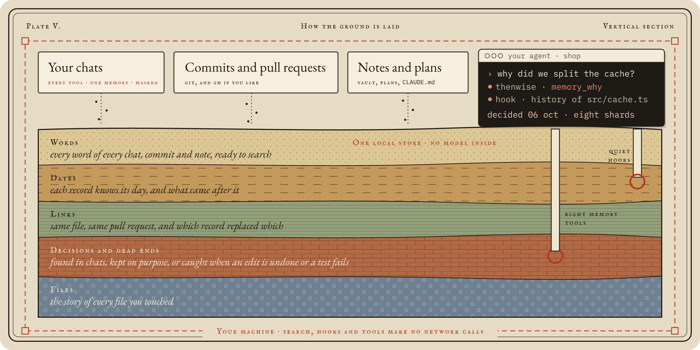

# Privacy

Your memory lives on your disk and nowhere else, whichever tool wrote it.

## How the ground is laid

<p align="center"></p>

| Keeps | Leaves out |
| --- | --- |
| Every Claude Code, Copilot CLI, Codex and Antigravity chat: your prompts and the replies, masked | Chats marked `[no-memory]`, and projects you pause |
| Commits from every branch, and pull requests if you like | Tool noise in search: file dumps, long command output and images are not indexed |
| Your CLAUDE.md files, dated, so an old rule and its replacement are told apart | Projects you leave out in `thenwise setup` |
| Every version of your plans, and the notes folders you list | Your own notes are read, never rewritten |

## Where everything lives

The data folder is `~/.thenwise`, or `THENWISE_HOME`. Folders are 0700 and files 0600.

- `archive/`: a masked copy of your Claude Code, Copilot CLI, Codex and Antigravity chats, and `archive/plans/` for plan versions.
- `graph.db`: the search store, built from the archive, git history and notes.
- `notes/`: notes you accepted from `distill`, with its state and log.
- `prs-cache.json` (only if PRs are on), `backup.json`, `vault.json`, `team-server/` (only if you host a team), `config.json`, `logs/` (no chat text, notes or queries), `hook-state/`, `forgotten.json`, `team.json` (only if you join a team).

Each tool's own chat files are only read, never changed.

## What masking catches

Keys and tokens become `[secret masked]` before a single byte is written. Masking knows the shape of AWS, GitHub, GitLab, Anthropic, OpenAI, Stripe, SendGrid, Twilio, Google, Slack, npm and Hugging Face keys, Slack webhooks, Google OAuth tokens, Docker registry logins, private key blocks, JWTs, passwords inside URLs (even with no user name) and `curl -u`, and any `SECRET=`, `TOKEN=`, `api_key:` or `stripe_key=` style line. It still catches a key that wraps across two lines, and leaves code like `process.env.API_KEY` readable. The team server masks again on arrival.

## What leaves the machine

None of your work, until you switch on one of these: PR lookups through `gh`, `distill` (through `claude -p`), Teams (only the notes and project chats you share), an export file you write, and an issue report you approve line by line.

`thenwise export` writes one project's chats to a file you can hand to someone. It holds exactly what Teams would share: the prompts and replies, masked, with the redact list applied and paths made relative to the repo. It never holds tool output, thinking, file contents, absolute paths, or chats marked `[no-memory]`, paused or forgotten. You see a preview first and nothing is written until you type yes. Anyone with the file can read it, so send it the way you would send the chats themselves. On the other side, `thenwise import` checks every chat the way the team server does, answers mark them (imported), and `thenwise import --remove <name>` takes them out again.

The one request on by default is the daily version check: the background sync makes one GET to npm for the newest Thenwise version, sending no version, id or project data, so npm sees only an IP address. Turn it off with `thenwise update-check off`, `"update_check": false` in config.json, or `THENWISE_NO_UPDATE_CHECK=1`.

## Off the record

`[no-memory]` at the start or end of a prompt, or on a line of its own, keeps that whole chat out. Add your own tags in `ingest.exclude_markers`.

## Pause

`thenwise off [--project <folder>]` stops archiving, plan history, and reading commits, PRs and CLAUDE.md of that project. Stored records stay until you `forget` them.

## Forget

```sh
thenwise forget <session id>        # one chat
thenwise forget <project folder>    # every chat of a project
```

It shows what will go and asks first (`--yes` skips the question), then removes the chat from the archive, the store, the hook state and vault backups, and unshares team notes made from it. A tombstone keeps it out of every later sync. It also names the copies that live elsewhere, such as each tool's own chat files, Copilot's sessions on GitHub and Time Machine.

## Back up the vault

Set `backup.kind` to `git` or `folders` in `config.json`. `thenwise backup` runs it now, and the sync runs it once a day. `git` commits the vault in its own repo and pushes only if `backup.push` is true. `folders` copies the vault into each folder in `backup.folders`. Backups never hold the archive or the store.

**Restore.** For `git`: `git -C <vault> log`, then `git checkout <commit> -- _thenwise`. For `folders`: copy `<folder>/<vault name>/_thenwise` back.

## Remove everything

`thenwise uninstall` stops the background sync and lists what to delete by hand. It deletes nothing itself.
